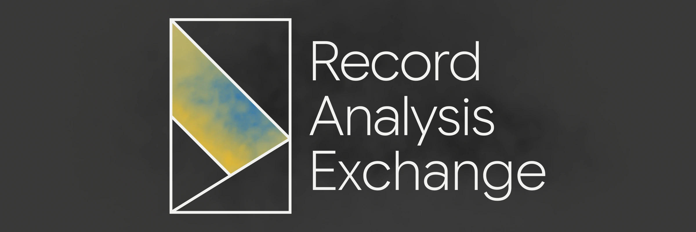

<p align="center">
  
</p>

<h1 align="center">TRAJS</h1>

<p align="center">
  Record, analyze and exchange agent trajectories.
</p>

<p align="center">
  <a href="https://tra.js.org/"><b>Docs</b></a> &nbsp;·&nbsp;
  <a href="#quickstart"><b>Quickstart</b></a> &nbsp;·&nbsp;
  <a href="#packages"><b>Packages</b></a> &nbsp;·&nbsp;
  <a href="#examples"><b>Examples</b></a> &nbsp;·&nbsp;
  <a href="#contributing"><b>Contributing</b></a>
</p>

<p align="center">
  <a href="https://tra.js.org/"></a>
  <a href="https://www.npmjs.com/package/@trajs/core"></a>
  <a href="./LICENSE"></a>
  
</p>

<details>
<summary><b>Contents</b></summary>

- [Why TRAJS](#why-trajs)
- [How it works](#how-it-works)
  - [Record](#record)
  - [Analyze](#analyze)
  - [Exchange](#exchange)
- [Architecture](#architecture)
  - [Repository layout](#repository-layout)
- [Installation](#installation)
  - [Requirements](#requirements)
  - [Install](#install)
- [Quickstart](#quickstart)
  - [CLI](#cli)
  - [As a library](#as-a-library)
- [Packages](#packages)
- [Documentation](#documentation)
- [Examples](#examples)
- [Roadmap](#roadmap)
- [Contributing](#contributing)
  - [Development](#development)
  - [Checks](#checks)
  - [Releases](#releases)
- [Community](#community)
- [Citation](#citation)
- [License](#license)

</details>

## Why TRAJS

<!-- The problem: what a model session loses today once the process exits —
     prompts, tool calls, intermediate state — and why that makes it impossible
     to replay, diff or benchmark. Then the three guarantees TRAJS gives. -->

## How it works

<!-- One paragraph introducing the three verbs below, and the shape they share. -->

### Record

<!-- How a session becomes a trajectory of typed, timestamped steps. -->

### Analyze

<!-- How trajectories are queried, compared and aggregated. -->

### Exchange

<!-- How trajectories leave the tool: formats, transport, and back again. -->

## Architecture

<!-- A small diagram (crates/packages/adapters) plus the two or three ideas that
     hold it together: the trajectory as the unit of storage, platform adapters,
     the OLAP path for analysis. -->

### Repository layout

<!-- One line per directory, what lives there and who consumes it:

| Path | Contents |
| --- | --- |
| `packages/core` | |
| `packages/olap` | |
| `packages/platform-*` | |
| `packages/utils` | |
| `apps/cli` | |
| `apps/viewer` | |
| `ui/*` | |
| `extensions/*` | |
| `tools/*` | |
| `examples/*` | |
| `tests/*` | |
-->

## Installation

### Requirements

<!-- Runtime and package manager, quoting the versions the repository enforces. -->

### Install

<!-- Install snippets, one per entry point (CLI, library, extension). -->

## Quickstart

<!-- The shortest path from nothing to a first recorded trajectory. -->

### CLI

<!-- Commands, expected output, and where the trajectory lands on disk. -->

### As a library

<!-- Imports, the smallest useful program, and what each call returns. -->

## Packages

<!-- Table: package, what it does, install command. Keep in sync with the
     release workflow and Changesets. -->

## Documentation

<!-- Links to the guides, the API reference and the LLM-readable pages the site
     also serves. -->

## Examples

<!-- `examples/traj-analysis` and friends: what each one demonstrates and how to
     run it. -->

## Roadmap

<!-- Shipped, next, exploring. Short enough that it stays true. -->

## Contributing

<!-- How to open an issue, the shape of a good pull request, and the paths that
     need a design note first. -->

### Development

<!-- Clone, install, run the site and the CLI from the workspace root. -->

```bash
vp install
vp run website
```

### Checks

<!-- The gate every pull request passes, run locally the same way. -->

```bash
vp check
vp test
```

### Releases

<!-- Changesets: what a changeset file is, when to add one, and how a release is
     cut from the Version Packages pull request. -->

## Community

<!-- Where discussion happens: issues for bugs, discussions for everything else,
     and the code of conduct every space follows. -->

## Citation

<!-- BibTeX entry for the paper or technical report, once there is one. -->

## License

TRAJS is released under the [MIT License](./LICENSE).

Copyright © 2026 Bowei Wang.
